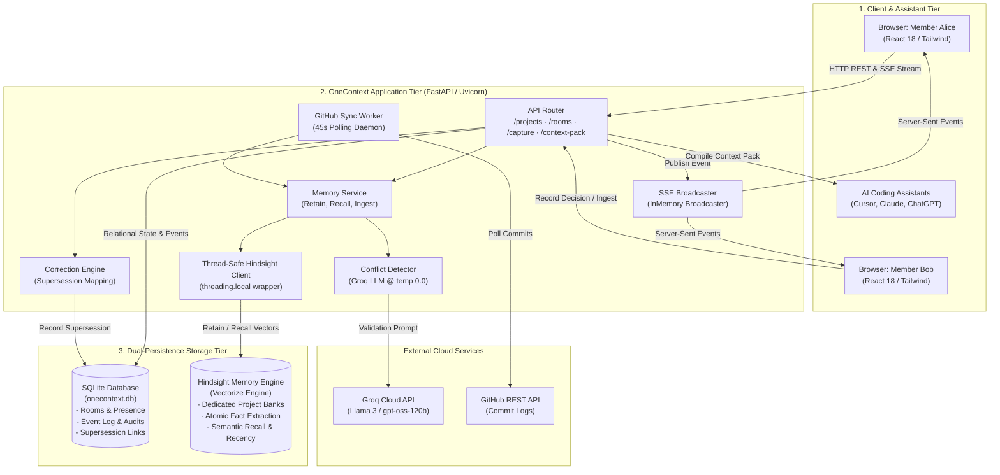
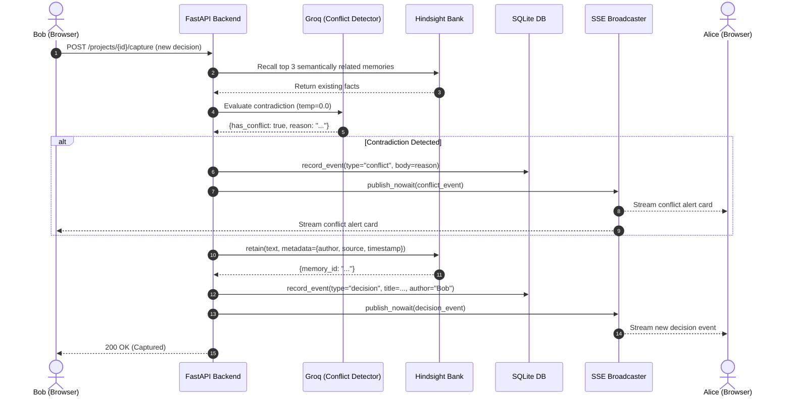
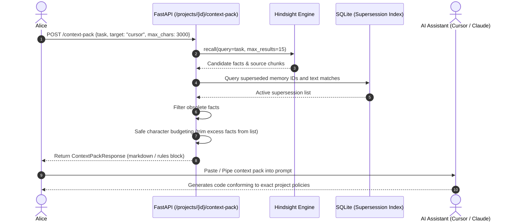

# OneContext System Architecture

OneContext is a collaborative agent-memory platform that establishes a single, synchronized architectural memory bank across human developers and disparate AI coding assistants (Cursor, Claude, ChatGPT, Copilot).

---

## 1. High-Level Architecture

The system consists of three primary tiers:
1. **Client & Assistant Tier**: Interactive React Single-Page Application (SPA) and external AI coding assistants that ingest compiled context packs.
2. **Application Tier**: A FastAPI backend providing synchronous and asynchronous REST endpoints, an in-memory Server-Sent Events (SSE) event bus, thread-safe memory wrappers, and LLM-assisted conflict validation.
3. **Storage & Memory Engine Tier**: A dual-persistence layout separating relational session metadata (SQLite) from semantic agent memory banks ([Hindsight](https://github.com/vectorize-io/hindsight)).



---

## 2. Core Workflows & Sequence Diagrams

### 2.1 Decision Capture, Conflict Detection & Real-Time Broadcast

When an engineer captures an architectural decision in Bob's browser:
1. OneContext checks Hindsight for semantically related prior decisions.
2. The candidates are evaluated against the new decision using Groq LLM at `temperature=0.0`.
3. If an incompatibility is found, an immediate non-blocking conflict warning is dispatched to SQLite and broadcast via SSE.
4. The decision is retained into the project's Hindsight bank.
5. All connected clients (e.g., Alice's window) receive the event within seconds.



---

### 2.2 Context Pack Compilation & Grounded Code Generation

When Alice is writing code and needs her AI assistant (Cursor, Claude, or ChatGPT) aligned with team policies:
1. Alice requests a context pack for a specific task (e.g., `"write webhook verification middleware"`).
2. OneContext recalls the most relevant memories from Hindsight.
3. The engine filters out superseded memories and duplicate facts.
4. The backend calculates character budgets: excess facts are trimmed from the bottom, guaranteeing that the wrapper boundary (`[END CONTEXT]`) and task prompt remain intact.
5. The formatted pack is injected or pasted into the assistant.



---

## 3. Subsystem Breakdown

### 3.1 Backend Core Modules (`backend/core/`)

| File | Purpose | Key Technical Details |
|---|---|---|
| [`hindsight_client.py`](file:///c:/Users/Suresh/Desktop/one_mem/onecontext/backend/core/hindsight_client.py) | Thread-Safe Hindsight Wrapper | Resolves `aiohttp` event loop binding issues across Uvicorn worker threads using `threading.local()` lazy instantiation. |
| [`memory_service.py`](file:///c:/Users/Suresh/Desktop/one_mem/onecontext/backend/core/memory_service.py) | Central Memory Orchestration | Encapsulates retain, recall, conflict checks, document ingestion, and supersession filtering. |
| [`broadcaster.py`](file:///c:/Users/Suresh/Desktop/one_mem/onecontext/backend/core/broadcaster.py) | Real-Time SSE Event Bus | In-memory asynchronous queue manager that broadcasts events per `project_id` to active HTTP SSE subscribers. |
| [`llm_client.py`](file:///c:/Users/Suresh/Desktop/one_mem/onecontext/backend/core/llm_client.py) | LLM Client Adapter | Connects to Groq (`openai/gpt-oss-120b`, `llama-3.3-70b-versatile`) with deterministic temperature (`0.0`) for validation and catch-up summaries. |

### 3.2 Backend API Routes (`backend/api/`)

| File | Endpoints | Responsibilities |
|---|---|---|
| [`projects.py`](file:///c:/Users/Suresh/Desktop/one_mem/onecontext/backend/api/projects.py) | `GET /projects`, `POST /projects` | Creates project namespaces and initializes corresponding Hindsight memory banks. |
| [`rooms.py`](file:///c:/Users/Suresh/Desktop/one_mem/onecontext/backend/api/rooms.py) | `/rooms/{team_id}/stream`, `/heartbeat`, `/events`, `/catch-up` | Manages presence, heartbeats, SSE event streaming, and LLM-generated catch-up summaries. |
| [`memory.py`](file:///c:/Users/Suresh/Desktop/one_mem/onecontext/backend/api/memory.py) | `/capture`, `/correct`, `/context-pack`, `/ask`, `/ingest` | Primary knowledge interface for recording decisions, triggering corrections, compiling context packs, and running grounded Q&A. |
| [`teams.py`](file:///c:/Users/Suresh/Desktop/one_mem/onecontext/backend/api/teams.py) | `/teams`, `/teams/{id}/join` | Room join code validation (6-character hex tokens) and active member rosters. |

### 3.3 Storage Separation: SQLite vs. Hindsight

```
+--------------------------------------------------------------------------------+
|                         Storage Responsibility Matrix                          |
+---------------------------------------+----------------------------------------+
|       SQLite (onecontext.db)          |        Hindsight Memory Engine         |
+---------------------------------------+----------------------------------------+
| - Projects & Room metadata            | - Dedicated project memory banks       |
| - Six-character join codes            | - Semantic vector indexing & search    |
| - Real-time presence & heartbeats     | - Atomic fact extraction from prose    |
| - Append-only activity event feed     | - Temporal recency & decay scoring     |
| - Audit logs (who, when, what)        | - Metadata tagging (source, author)    |
| - Supersession mappings (old -> new)  | - Natural language semantic recall     |
+---------------------------------------+----------------------------------------+
```

---

## 4. Frontend Architecture (`frontend/src/`)

The frontend is a lightweight Single Page Application powered by **React 18**, **Vite**, and **Tailwind CSS**:

* **`App.jsx`**: Central navigation router and project context provider.
* **`LiveRoom.jsx`**: Real-time room activity feed, live presence member pills, SSE listener with automatic fallback polling, and quick decision capture bar.
* **`ContextPack.jsx`**: Context pack configuration UI allowing engineers to specify tasks, target assistants (Cursor, Claude, ChatGPT, Generic), and copy prompt blocks.
* **`MemoryExplorer.jsx`**: Visual exploration of recalled facts, active vs. superseded memories, and metadata filters.
* **`Team.jsx`**: Collaborative room settings, member heartbeats, and join-code generation.

---

## 5. Concurrency & Concurrency Guarantees

1. **Worker Thread Concurrency**: FastAPI runs synchronous database operations on thread pools. The `HindsightWrapper` allocates client sessions per thread via `threading.local()`, preventing loop collisions in `aiohttp`.
2. **SSE Backpressure**: `broadcaster.py` utilizes non-blocking `asyncio.Queue` instances per listener. If an SSE connection slows down, `publish_nowait` discards or drops frames gracefully without blocking the main worker loop.
3. **Write-Time Non-Blocking Warning**: Conflict detection executes synchronously before retention; however, detections are surfaced as warning events rather than terminating writes with HTTP 4xx/5xx errors, preserving developer flow.
