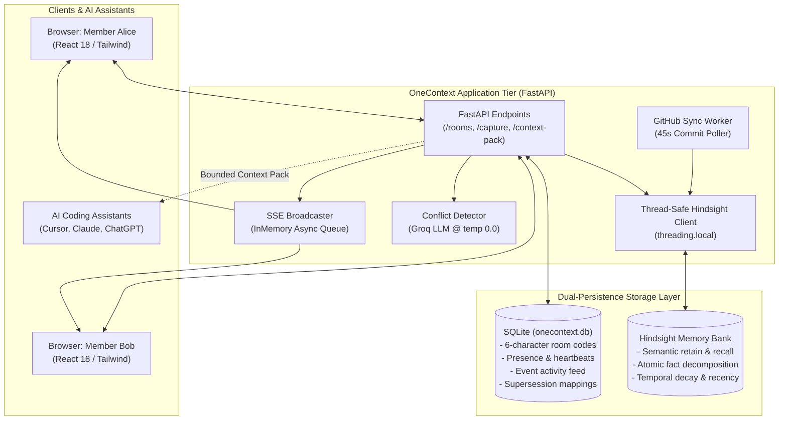

# OneContext

> **One project. One memory. Every AI assistant.**

[](https://www.python.org/)
[](https://fastapi.tiangolo.com/)
[](https://react.dev/)
[](https://github.com/vectorize-io/hindsight)
[](https://opensource.org/licenses/MIT)

OneContext is a collaborative agent-memory platform for software engineering teams. It connects human developers and disparate AI coding assistants (**Cursor, Claude, ChatGPT, Copilot**) to a single, synchronized architectural memory bank powered by [Hindsight](https://github.com/vectorize-io/hindsight), the open-source agent memory engine from Vectorize.

---

## ⚡ The Core Problem

Modern software engineers frequently work across multiple specialized AI tools: Cursor in the IDE, Claude in a browser tab, and ChatGPT for design reviews. However, these assistants operate in **isolated silos**:

* **Ghost Contracts**: When a teammate updates an API schema or changes database pool limits, your assistant has zero knowledge of the change until code review or CI breaks.
* **Vector Search Invalidation Failure**: Standard RAG simply scores semantic similarity. If a team picks Postgres in January and migrates financial ledgers to CockroachDB in June, vector search pulls both documents because the words match, causing assistants to follow obsolete guidelines.
* **Prompt Bloat & Token Waste**: Ingesting dozens of entire architecture documents into an assistant's prompt wastes context budget and degrades instruction following.
* **Silent Contradictions**: Standard vector storage accepts contradictory rules (e.g., snake_case vs camelCase) without warning.

---

## 💡 The OneContext Solution

OneContext pairs each project with an isolated **Hindsight** memory bank and exposes real-time collaboration tools:

1. **Real-Time Synchronized Rooms**: Connect team members via 6-character room codes. When Bob captures a decision in his browser, Alice's live feed updates within seconds over Server-Sent Events (SSE).
2. **Write-Time Conflict Detection**: Before saving a decision, OneContext recalls prior policies and runs a zero-temperature LLM check to flag contradictions without blocking developer flow.
3. **Explicit Decision Supersession**: When a policy evolves, the old decision is marked superseded, and Hindsight's decomposed sub-facts are filtered out of active recall.
4. **Targeted Context Packs**: Compile bounded, prompt-ready markdown blocks formatted specifically for Cursor, Claude, or ChatGPT. Facts are safely truncated from the bottom, guaranteeing that closing markers and developer tasks are never cut off.
5. **AI "Catch Me Up"**: Summarize all team architectural decisions logged since your last active session in one click.

---

## 🏗️ System Architecture

OneContext uses a dual-persistence architecture separating relational session state from semantic agent memory:



For full details, sequence diagrams, and concurrency guarantees, see [`ARCHITECTURE.md`](ARCHITECTURE.md).

---

## 🚀 Quick Start (Windows / Linux / macOS)

### 1. Prerequisites
* **Python 3.11+** installed
* **Node.js 18+** and **npm** installed
* Free API keys for:
  * **[Hindsight Cloud](https://hindsight.vectorize.io)** (or local Hindsight instance)
  * **[Groq Cloud](https://groq.com)** (for high-speed conflict detection and catch-up summaries)

### 2. Configure Environment Variables
Copy `.env.example` to `.env` inside `onecontext/`:
```bash
cp onecontext/.env.example onecontext/.env
```
Add your credentials:
```ini
HINDSIGHT_API_KEY=your_hindsight_api_key_here
HINDSIGHT_BASE_URL=https://api.hindsight.vectorize.io

GROQ_API_KEY=your_groq_api_key_here
GROQ_PRIMARY_MODEL=openai/gpt-oss-120b
GROQ_FALLBACK_MODEL=qwen/qwen3.8-27b
```

### 3. Start the Backend & Frontend
You can launch both services with the provided batch scripts, or manually in two terminals:

#### Terminal 1 — Backend (FastAPI):
```powershell
cd onecontext
python -m uvicorn backend.main:app --reload --host 0.0.0.0 --port 8000
```

#### Terminal 2 — Frontend (Vite + React):
```powershell
cd onecontext/frontend
npm install
npm run dev -- --host 0.0.0.0 --port 5173
```

Open **`http://localhost:5173`** in your browser.

---

## 🎮 Interactive Walkthrough (3 Minutes)

Experience the collaborative multi-assistant workflow in two browser windows:

1. **Open Two Windows Side by Side**:
   * Window 1 (Normal browser): Join a project room as **Alice**.
   * Window 2 (Incognito window): Join the same room as **Bob** using the 6-character room code.
   * Observe active presence indicators in the room sidebar.
2. **Capture an Architecture Decision**:
   * In Bob's window, record:  
     `Outbound merchant webhooks must use HMAC-SHA256 signatures with a 300-second timestamp drift window.`
   * Watch the decision appear in Alice's live feed within a few seconds via Server-Sent Events.
3. **Trigger Write-Time Conflict Detection**:
   * In Bob's window, attempt to submit:  
     `Outbound merchant webhooks must use plain MD5 checksums with no timestamp validation.`
   * Observe the side-by-side **Conflict Warning Card** highlighting the contradiction between the old and new rules.
4. **Generate a Cursor / Claude Context Pack**:
   * In Alice's window, navigate to the **Context Pack** tab.
   * Enter task: `Write the webhook verification middleware`. Select **Cursor**.
   * Click **Generate Context Pack**. Copy the bounded prompt block and paste it into your assistant.

---

## 🔬 Grounding Evaluation (Before vs. After)

We measured the assistant's behavior on the same query with and without OneContext:

> **Developer Query:** *"What is our policy on public API protocols and database pooling?"*

| Aspect | Without Context Pack (Ungrounded) | With OneContext Pack (Hindsight Grounded) |
|---|---|---|
| **Response** | *"I’m sorry—I don’t have access to your organization’s internal documentation... However, common industry best practices include HTTPS, OAuth 2.0, and standard pooling."* | Cites exact internal policies: **RESTful HTTP with OpenAPI v3.1 schemas strictly enforced; GraphQL & gRPC prohibited on public gateways; DB pooling capped at 20 connections per pod.** |
| **Accuracy** | Generic, non-compliant advice | 100% compliant with internal architecture standards |
| **Hallucination** | High risk of incompatible specs | Zero hallucinated parameters |

---

## 📂 Project Structure

```text
onecontext/
├── backend/
│   ├── main.py                  # FastAPI application entry point, lifespan, CORS
│   ├── config.py                # Pydantic v2 application configuration
│   ├── core/
│   │   ├── hindsight_client.py  # Thread-safe lazy Hindsight wrapper (threading.local)
│   │   ├── memory_service.py    # Retain, recall, document ingest, and supersession
│   │   ├── broadcaster.py       # Real-time Server-Sent Events (SSE) event bus
│   │   └── llm_client.py        # Groq client with exponential retry & model fallback
│   ├── api/
│   │   ├── memory.py            # /capture, /correct, /context-pack, /ask, /ingest
│   │   ├── rooms.py             # /rooms/{id}/stream, /events, /heartbeat, /catch-up
│   │   ├── projects.py          # /projects CRUD & Hindsight bank initialization
│   │   └── teams.py             # Team rosters and 6-character room join codes
│   ├── services/
│   │   └── github_sync.py       # 45s background polling worker for GitHub commit sync
│   └── storage/
│       └── local_db.py          # SQLite database schema (rooms, events, supersessions)
├── frontend/
│   ├── src/
│   │   ├── pages/
│   │   │   ├── LiveRoom.jsx     # Real-time team room, presence, SSE stream, quick capture
│   │   │   ├── ContextPack.jsx  # Context pack compiler for Cursor, Claude, ChatGPT
│   │   │   ├── MemoryExplorer.jsx # Visual fact browser, supersession tags, search
│   │   │   ├── Dashboard.jsx    # Project overview and health status
│   │   │   └── Team.jsx         # Collaborative room settings & join codes
│   │   ├── components/          # Navigation, conflict cards, status badges
│   │   └── api/client.js        # Axios REST client
├── scripts/
│   ├── demo_context_pack.py     # Terminal demonstration of before/after grounding
│   └── seed_data.py             # Seed script for realistic engineering standards
├── ARCHITECTURE.md              # Complete architecture specification & diagrams
├── article.md                   # First-person technical write-up
└── README.md                    # This file
```

---

## 🛠️ API Reference Summary

| Endpoint | Method | Description |
|---|---|---|
| `/projects` | `GET`, `POST` | List projects or provision a new project and Hindsight bank |
| `/projects/{id}/capture` | `POST` | Retain a new architectural decision with write-time conflict checks |
| `/projects/{id}/correct` | `POST` | Supersede an obsolete decision with replacement text |
| `/projects/{id}/context-pack` | `POST` | Compile a length-bounded markdown context pack for Cursor/Claude |
| `/projects/{id}/ask` | `POST` | Ask a question grounded in the project's Hindsight memory bank |
| `/rooms/{id}/stream` | `GET` | Connect to live Server-Sent Events (SSE) room activity feed |
| `/rooms/{id}/heartbeat` | `POST` | Register client presence heartbeat in SQLite |
| `/rooms/{id}/catch-up` | `GET` | Generate an LLM summary of decisions since last active session |

---

## 📄 License

MIT License. Engineered for modern engineering teams and multi-agent workflows.
