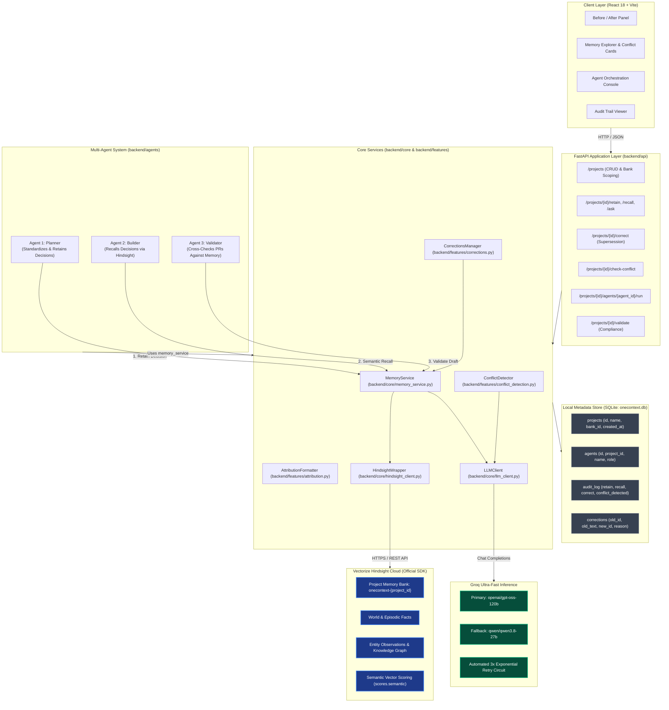
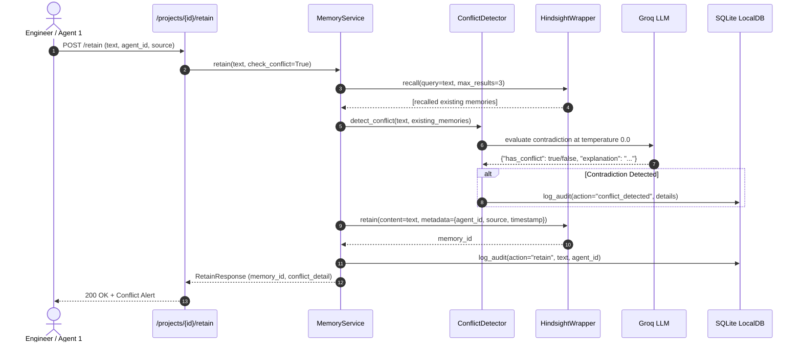

# OneContext Architecture & Technical Specification

> **One project. One memory. Every agent.**

OneContext provides a shared, long-term memory layer for autonomous AI agents and human software engineers. By attaching every engineering project to a dedicated memory bank on **Vectorize Hindsight Cloud**, OneContext eliminates context drift, prevents contradictory AI decisions, and enforces architectural compliance across distributed agent workflows.

---

## 1. System Overview & Architecture Diagram



---

## 2. Core Architecture Invariants

1. **Isolation by Design**: All actual memory content, fact extraction, semantic embeddings, and observations reside in **Vectorize Hindsight Cloud**.
2. **Local DB Scope**: The local SQLite database (`onecontext.db`) stores **only** system metadata: project definitions, registered agent profiles, supersession mappings, and an append-only audit trail. Real project knowledge is never duplicated into SQLite.
3. **Dedicated Hindsight Wrapper**: All interactions with Hindsight are encapsulated inside [`backend/core/hindsight_client.py`](file:///c:/Users/Suresh/Desktop/one_mem/onecontext/backend/core/hindsight_client.py). No other file imports `hindsight-client` directly.
4. **No Manual Agent Handoffs**: Agent 2 (Builder) and Agent 3 (Validator) receive zero context from Agent 1 (Planner) via prompts, parameters, or session memory. Cross-agent coordination happens **strictly** via semantic recall against the shared Hindsight bank.
5. **Authentic Data Integrity**: Hindsight returns real semantic match scores via `scores.semantic` on `RecallResult`. OneContext surfaces these exact values directly in the UI (`Score: 0.XX`) without fabricating percentages or artificial metrics.

---

## 3. Data Flow & Execution Lifecycles

### 3.1 Decision Retention & Automated Conflict Detection


### 3.2 Grounded Answering (`/ask`) with Supersession Filtering
When a question is asked:
1. `MemoryService.recall()` queries Hindsight with `include_superseded=False`.
2. OneContext checks the SQLite `corrections` registry to identify superseded memory IDs and original superseded source texts.
3. **Multi-Fact Derivation Exclusion**: Any atomic fact or entity observation derived from a superseded decision is purged from active retrieval.
4. The remaining active facts are compiled into an authoritative context block:
   ```text
   === PROJECT MEMORY CONTEXT ===
   [1] (Source: architecture_decision, Author: db-architect)
   DECISION: Standardize all transactional persistence on PostgreSQL 16 using asyncpg...
   ==============================
   ```
5. Groq (`openai/gpt-oss-120b`) synthesizes a grounded answer citing the active decisions.
6. The operation is logged in the audit trail (`action="ask"`).

### 3.3 Memory Correction & Historical Supersession (`/correct`)
When an architectural standard changes (e.g. reverting an experimental proposal):
1. The user or agent invokes `POST /projects/{id}/correct` with `old_memory_id`, `new_text`, and `reason`.
2. The new memory is ingested into Hindsight carrying metadata `{"supersedes": old_memory_id, "reason": reason}`.
3. The relationship is recorded in SQLite's `corrections` table alongside `old_memory_text`.
4. Subsequent recalls automatically exclude both the old memory ID and all sub-facts derived from the original text, ensuring total alignment across all agents.

---

## 4. Multi-Agent System Roles

| Agent | Module | Role | Hindsight Interaction |
|---|---|---|---|
| **Agent 1: Planner** | [`backend/agents/agent_one.py`](file:///c:/Users/Suresh/Desktop/one_mem/onecontext/backend/agents/agent_one.py) | Formulates architectural policies, database choices, compliance limits | Writes decisions to Hindsight with `agent_id: agent-planner` |
| **Agent 2: Builder** | [`backend/agents/agent_two.py`](file:///c:/Users/Suresh/Desktop/one_mem/onecontext/backend/agents/agent_two.py) | Generates implementation plans and technical specifications | Discovers standards strictly via semantic recall from Hindsight |
| **Agent 3: Validator** | [`backend/agents/validator_agent.py`](file:///c:/Users/Suresh/Desktop/one_mem/onecontext/backend/agents/validator_agent.py) | Reviews pull requests and code proposals for compliance | Recalls project decisions, detects contradictions, flags violations |

---

## 5. Resilient LLM Inference Engine

OneContext implements an automatic fallback circuit inside [`backend/core/llm_client.py`](file:///c:/Users/Suresh/Desktop/one_mem/onecontext/backend/core/llm_client.py):
- **Primary Model**: `openai/gpt-oss-120b` (on Groq Cloud) for complex reasoning and synthesis.
- **Fallback Model**: `qwen/qwen3.8-27b` (on Groq Cloud) for high-throughput resilience.
- **Retry Logic**: If the primary model encounters rate limits (HTTP 429), gateway timeouts (HTTP 504), or internal errors, the client retries with exponential backoff before cleanly switching to the fallback model.
- **Model Tracking**: Every API response records the exact `model_used` in its response metadata for full observability.

---

## 6. Local SQLite Schema (`onecontext.db`)

```sql
CREATE TABLE projects (
    id TEXT PRIMARY KEY,
    name TEXT NOT NULL,
    description TEXT,
    bank_id TEXT NOT NULL,
    created_at TEXT NOT NULL
);

CREATE TABLE agents (
    id TEXT PRIMARY KEY,
    project_id TEXT NOT NULL,
    name TEXT NOT NULL,
    role TEXT,
    created_at TEXT NOT NULL,
    FOREIGN KEY (project_id) REFERENCES projects(id)
);

CREATE TABLE audit_log (
    id TEXT PRIMARY KEY,
    project_id TEXT NOT NULL,
    agent_id TEXT NOT NULL,
    action TEXT NOT NULL,  -- retain, recall, ask, validate, correct, conflict_detected
    query_or_text TEXT,
    result_count INTEGER DEFAULT 0,
    timestamp TEXT NOT NULL
);

CREATE TABLE corrections (
    id TEXT PRIMARY KEY,
    project_id TEXT NOT NULL,
    old_memory_id TEXT NOT NULL,
    old_memory_text TEXT,
    new_memory_id TEXT NOT NULL,
    reason TEXT,
    created_at TEXT NOT NULL
);
```
